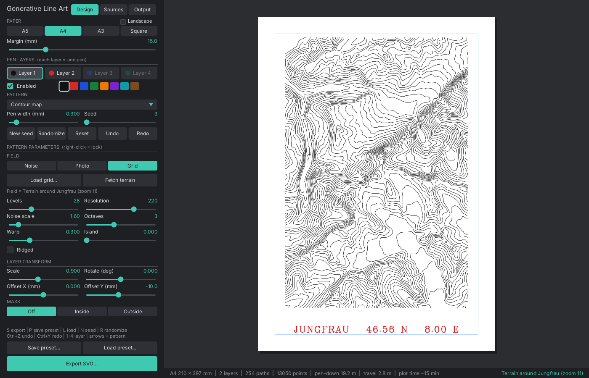

# PlotterGraph

Generative line art with a live-adjustable GUI, built as a single [Processing](https://processing.org/) sketch. Designed for pen plotters: everything exports as clean, millimetre-accurate SVG.



## Features

- **35 patterns** — flow field, wave lines, spirograph, noise rings, Lissajous, contour map, Truchet tiles, hatch shading, strange attractor, superformula, nested polygons, spiral, moire circles, circle packing, harmonograph, Hilbert curve, sunburst, maze, L-system, guilloche, Maurer rose, phyllotaxis, subdivision, warped grid, fractal tree, Voronoi, image, hex Truchet, Penrose, hex maze, route, data lines, SVG import, audio, text.
  - **Maze** — recursive-backtracker maze drawn as walls or as its centre-line path (same seed on two layers = walls + solution-style path in a second pen). Wall segments are merged into long strokes to minimise pen lifts.
  - **L-system** — Koch snowflake, dragon curve, Gosper curve, Sierpinski arrowhead and a branching plant, with angle tweak, jitter and smoothing.
  - **Guilloche** — banknote-style rosettes: interleaved lines oscillating between two lobed envelopes.
  - **Maurer rose** — straight chords stepping around a rose curve; optional rose outline and extra copies with a shifted step.
  - **Phyllotaxis** — golden-angle sunflower layout drawn as circles, radial dashes or the Fibonacci spiral families.
  - **Subdivision** — recursive rectangle splits, cells filled with serpentine (single-stroke) hatching, cross-hatching or concentric squares.
  - **Warped grid** — op-art line grid bent by lens bulges (or pinches) and optional noise.
  - **Fractal tree** — recursive branches with angle/length randomness and bend; each branch continues the parent stroke.
  - **Voronoi** — Lloyd-relaxed cells with shared borders drawn once, plus optional smoothed inset rings ("pebbles").
  - **Image** — turn a photo (PNG/JPG/GIF) into a single-stroke TSP line, stipple dots, tone-based cross-hatching, a wiggling spiral or squiggle lines. Contrast, brightness and invert controls; without a photo a built-in demo picture is used.
  - **Hex Truchet** — hexagonal Truchet tiles with arcs, mixed straight/arc tiles or a random mix; strokes are joined across tiles.
  - **Penrose** — P3 rhomb tiling by Robinson-triangle subdivision, drawn as rhombs, as matching arcs (closed loops) or both.
  - **Hex maze** — recursive-backtracker maze on a hexagon grid, as walls or centre-line path, with optional loops.
  - **Route** — GPX tracks, GeoJSON lines/polygons or OpenStreetMap streets, with smoothing, parallel copies and a rectangle or circle frame (a "city map" poster).
  - **Data lines** — numbers from a CSV or JSON file as stacked ridgelines ("Unknown Pleasures"), rings or a spiral.
  - **SVG import** — paths, shapes and transforms from an SVG file, outlined and/or filled with (cross-)hatching.
  - **Audio** — a WAV / AIFF file as waveform rows, a waveform spiral or a spectrum ridgeline.
  - **Text** — single-line Hershey fonts (sans, serif, script): each letter is one pen stroke, not an outline.
- **External sources** (Sources tab) — photos, data, maps, terrain, weather, SVG, audio and text from files, web addresses or a watched folder; text-to-design; AI-generated designs; a command-line mode. See [External sources](#external-sources).
- **Field sources** — Flow field, Wave lines, Contour map and Hatch shading can follow a photo or a grid (CSV matrix, elevation data, heightmap) instead of noise.
- **Up to 4 pen layers** — each with its own pattern, seed, parameters, pen colour, pen width, scale/rotate/offset transform and mask. Combine patterns, or plot each layer with a different pen.
- **Live preview** — drag sliders, pick paper size (A5/A4/A3/Square, portrait or landscape), and see the result update immediately.
- **Undo / redo** — every parameter change (a whole slider drag counts as one step), up to 200 steps.
- **Parameter locks** — right-click a pattern parameter or the seed to lock it; Randomize, New seed and batch export leave locked values alone.
- **Masks** — keep a layer only inside or outside a shape: typed text (use `|` for a new line) in any font installed on your system, or a loaded PNG/JPG/GIF/SVG silhouette, with threshold and invert.
- **Plot time estimate** — pen-down distance, pen-up travel and number of pen lifts per layer, turned into a plot time from your plotter's speeds.
- **Path clean-up** — simplification (Ramer-Douglas-Peucker), joining paths whose ends nearly touch, dropping tiny fragments and duplicate paths, and nearest-neighbour travel optimisation. The preview, statistics and export all use the cleaned-up paths.
- **Registration marks and pen test swatches** — optional corner crosshairs drawn by every pen (to line the paper up after a pen change) and a small test patch per pen, plotted first, in the bottom margin.
- **Export** — SVG (real paper size in millimetres, one Inkscape layer per pen), G-code (GRBL-style, Z-axis or servo pen lift) or HPGL; optionally one file per pen.
- **Batch export** — write a series of variations (seed +1, +2, …) in one go into `exports/batch_<timestamp>/`.
- **Presets** — save and load the full setup (paper, output settings, mask, all 4 layers including locks) as JSON. A handful of example presets are included in [`GenerativeLineArt/presets`](GenerativeLineArt/presets).

## Running it

Open [`GenerativeLineArt/GenerativeLineArt.pde`](GenerativeLineArt/GenerativeLineArt.pde) in the [Processing IDE](https://processing.org/download) (4.x) and press Run. No extra libraries are required. The sketch is split over several tabs (`Sources`, `DataPatterns`, `SvgImport`, `Audio`, `TextFont`, `AiDesign`, `Cli`), which the IDE opens together.

## Controls

- **Design / Sources / Output tabs** at the top of the panel: *Design* holds the paper, layers and pattern parameters; *Sources* loads external data (see below); *Output* holds the plotter speeds and time estimate, path clean-up, registration marks / pen test, mask source, export format and batch export.
- **Sliders / dials** in the left panel adjust the current layer's parameters live. Mouse wheel over a slider = fine adjustment; elsewhere in the panel it scrolls.
- **Right-click** a pattern parameter or the seed to lock / unlock it (a padlock appears next to its name).
- **Layer tabs** (1–4) switch which pen layer you're editing.
- **Pattern dropdown** picks the pattern for the current layer; Left/Right arrow keys cycle through patterns.
- **New seed / Randomize / Reset** buttons (or `N`/`Space`, `R`) regenerate the current layer.
- **Undo / Redo** buttons, or `Ctrl+Z` and `Ctrl+Y` / `Ctrl+Shift+Z` (`Cmd` on macOS).
- **Mask** (Design tab, per layer): Off / Inside / Outside. Pick the text or image on the Output tab.
- **Font** (Output tab, text mask): click to open a list of every installed font. Type to filter it (e.g. `bold`), scroll with the mouse wheel or Up/Down, then click a font or press Enter. The font is saved in presets; if a preset's font isn't installed, the current font stays.
- **Export ...** (or `S`) opens a save dialog in the chosen format; a quick-save also writes into `GenerativeLineArt/exports/`.
- **Save preset... / Load preset...** (or `P`, `L`) store/restore the whole setup as JSON in `GenerativeLineArt/presets/`.
- **Text fields** (mask text, URL, place, prompt): click to type, `Ctrl+V` / `Cmd+V` pastes, `Enter` runs the button next to the field.

## External sources

Everything on the **Sources** tab brings outside data into a design. When a source is loaded, a layer switches to the pattern that draws it (unless an enabled layer already does; if the current layer already shows another source, the next free layer is used, so sources add up on separate pens). Presets remember the sources: downloads are kept in `GenerativeLineArt/cache/`, so a preset keeps giving the same design, also offline.

| Source | How | Drawn by |
|---|---|---|
| Photo (PNG/JPG/GIF) | *Photo...*, URL, watch folder | Image pattern, or as a field |
| CSV / JSON numbers | *CSV / JSON...*, URL | Data lines |
| GPX / GeoJSON | *GPX / GeoJSON...*, URL | Route |
| OpenStreetMap streets, water, buildings | *Fetch streets* (place + radius) | Route |
| Terrain (elevation) | *Fetch terrain* (place + zoom) | Contour map (field = Grid) |
| Weather (hourly temperature, last 92 days) | *Fetch weather* (place) | Data lines, one row per day |
| Grid: CSV matrix, ESRI `.asc`, grey-scale heightmap | *Grid / DEM...* | field = Grid |
| SVG | *SVG...*, URL | SVG import |
| Audio (WAV/AIFF/AU) | *Audio...*, URL | Audio |
| Text (`.txt`) | URL, watch folder | Text |
| Preset (`.json` with `layers`) | URL, watch folder | — |

- **Location** — type a place name (looked up with OpenStreetMap Nominatim) or `lat, lon`, then *Find*. *Radius* sets the street area, *Terrain zoom* the terrain detail (higher = smaller area).
- **CSV** — every numeric column becomes a series; text columns and constant columns are skipped, the header gives the names. Comma, semicolon (with decimal commas, as Dutch Excel writes them), tab and `|` are recognised. When a date column runs newest-first, the rows are put in date order. **JSON** — every array of numbers, or array of objects with numeric fields, becomes a series.
- **Data lines** — *Row length* cuts a long series into rows (0 = automatic; hourly weather gives rows of 24). *Scale per row* normalises each row on its own.
- **Field** (Design tab, for Flow field, Wave lines, Contour map, Hatch shading) — *Noise* is the classic behaviour; *Photo* follows the darkness of the loaded photo (or a demo); *Grid* follows the loaded grid / terrain. The field covers the drawing area.
- **Web address** — paste a link to any of the file types above and press *Fetch URL*; the type comes from the link or the content.
- **Watch folder** — choose a folder and tick *Watch*: every new file dropped into it is loaded, and with *Auto-export* the result is written to `exports/<file name>_<time>.<ext>`. Handy with OneDrive / SharePoint sync or Power Automate.
- **Text → design** — *Seed from text* turns a name or phrase into the layer's seed; *Design from text* also picks the pattern and its parameters. The same text always gives the same design (e.g. one design per customer or guest).
- **AI design** — describe a design ("calm ocean waves in two blues, A3 landscape") and Claude returns a preset, which is applied (Undo takes it back). This needs an Anthropic API key in the `ANTHROPIC_API_KEY` environment variable, set before starting Processing (optionally `ANTHROPIC_BASE_URL` for a gateway). The prompt, the list of patterns and the names of loaded sources are sent to the Anthropic API; nothing else.

Map data © [OpenStreetMap](https://www.openstreetmap.org/copyright) contributors (ODbL); credit it when you publish a plot. Terrain: [Terrarium elevation tiles](https://registry.opendata.aws/terrain-tiles/) (AWS Open Data). Weather: [Open-Meteo](https://open-meteo.com/). These services are free for light use; please don't hammer them.

### Example: Microsoft 365 usage as a plot

Usage reports from Microsoft Graph are CSV files, so they can be plotted directly. With the [Microsoft Graph PowerShell SDK](https://learn.microsoft.com/powershell/microsoftgraph/):

```powershell
Connect-MgGraph -Scopes Reports.Read.All
Get-MgReportEmailActivityCount -Period D90 -OutFile email_activity.csv
```

Drop `email_activity.csv` into the watched folder (or load it with *CSV / JSON...*): Send, Receive and Read become three data lines, oldest day first.

## Command line

The sketch can run without the GUI, for scripts, scheduled tasks or flows. Arguments go after `--run` (or straight to an exported application):

```sh
Processing cli --sketch=GenerativeLineArt --run --preset presets/wave_lines_a3.json --out exports/waves.svg
Processing cli --sketch=GenerativeLineArt --run --input route.gpx --text "Sunday ride" --layer 2 --format gcode --out ride.gcode
Processing cli --sketch=GenerativeLineArt --run --location "Utrecht" --streets major --radius 2000 --out utrecht.svg
Processing cli --sketch=GenerativeLineArt --run --design-text "Anna & Tom" --batch 10
Processing cli --sketch=GenerativeLineArt --run --watch C:\Plots\Inbox
```

Options: `--preset`, `--input <file|url>` (repeatable), `--grid`, `--layer`, `--location`, `--streets [all|major|water|buildings]`, `--radius`, `--terrain [zoom]`, `--weather`, `--text`, `--seed`, `--seed-text`, `--design-text`, `--prompt`, `--paper`, `--landscape` / `--portrait`, `--format svg|gcode|hpgl`, `--out`, `--batch <n>`, `--watch <folder>`, `--help`. Relative paths are relative to the current directory. Without `--watch` the window stays hidden and the sketch quits after exporting, with exit code 1 when something failed. On a Linux server without a display, run it under `xvfb-run`.

## Plotting

Exported SVGs use millimetre units matching the chosen paper size, with each pen layer as a separate `<g>` (Inkscape layer) so multi-pen plots can be sent one layer at a time to software like Inkscape + the AxiDraw extension, vpype, or similar plotter tools.

**G-code** is written for GRBL-style pen plotters: millimetres, absolute coordinates, `G1` moves at the pen-down / travel speeds set on the Output tab, and the pen lifted either with the Z axis (`G0 Z<up>` / `G1 Z<down>`) or a servo (`M3 S<up>` / `M3 S<down>`). After every lift there is a `G4 P<seconds>` dwell (GRBL takes seconds; Marlin reads `P` as milliseconds, so set the lift time to 0 there). By default the origin is the bottom-left corner with Y pointing up; untick *Origin bottom-left* for a top-left origin. With several layers in one file the plotter returns to the origin and pauses (`M0`) for each pen change.

**HPGL** uses 40 plotter units per mm with the origin bottom-left; layer *n* is drawn with pen *n* (`SP1`–`SP4`), so a pen carousel can plot all layers in one go.

The time estimate is pen-down distance ÷ pen-down speed + travel ÷ travel speed + 2 × pen-lift time per stroke. Acceleration is ignored, so treat it as a rough guide.

## License

CC0 1.0 Universal — see [LICENSE](LICENSE). The Hershey font data in `GenerativeLineArt/data/` comes with its own notice ([`HERSHEY_FONTS_NOTICE.txt`](GenerativeLineArt/data/HERSHEY_FONTS_NOTICE.txt)).
